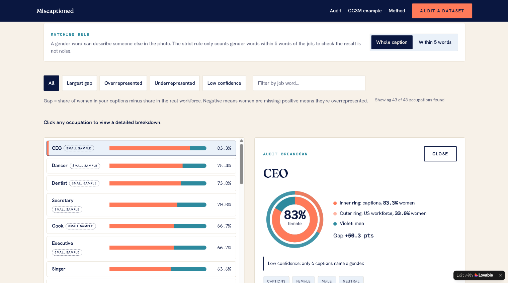
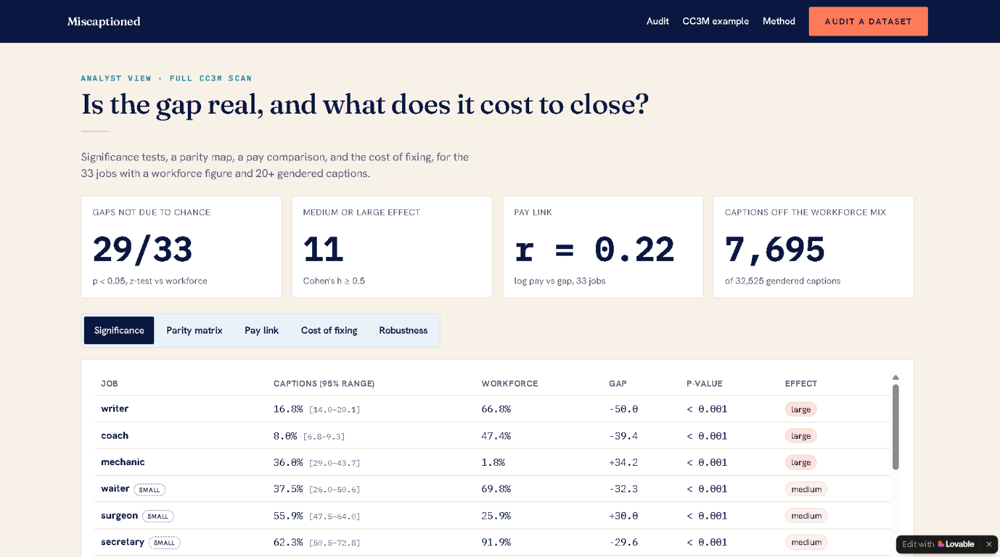
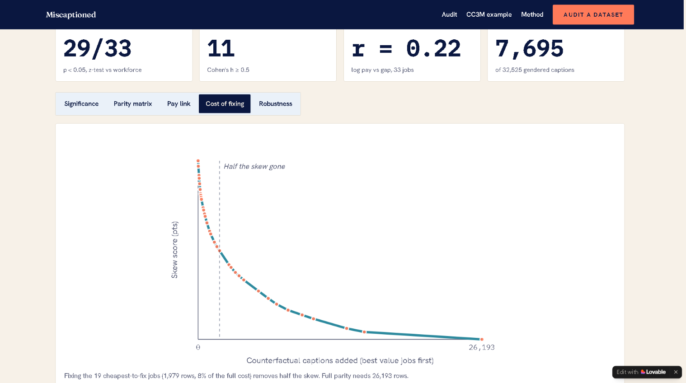
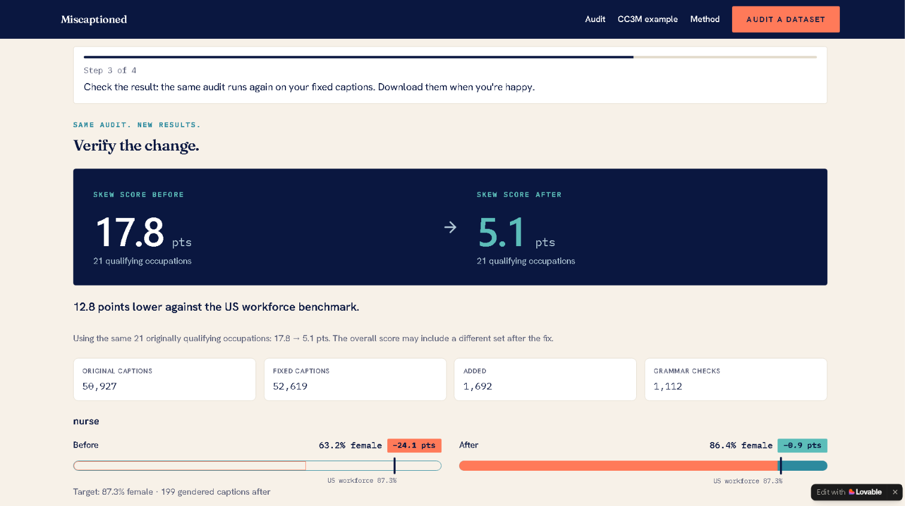

# Miscaptioned: Auditing Gender Skew in AI Training Captions

**Live interactive tool:** https://caption-bias-visualizer.lovable.app  
**Analysis Repository:** https://github.com/lek-l/miscaptioned-analysis

> Do the captions used to train image AI describe women and men in each job the way the real workforce looks? This project measures the gap against US Bureau of Labor Statistics data, tests statistical significance, evaluates heuristic robustness, and models cost-optimal remediation.

---

## Executive summary

| | |
| :--- | :--- |
| **Question** | Do AI image-caption datasets under- or over-represent women in specific jobs compared with the US workforce? |
| **Data** | Google Conceptual Captions (CC3M, 3.3M captions) vs US Bureau of Labor Statistics CPS Table 11 |
| **Scope** | 33 occupations with 20+ gendered captions (32,525 gendered caption matches) |
| **Headline** | Captions sit on average **19.2 points** away from each job's real share of women (17.8 on the 50,927-caption in-browser sample) |
| **Statistical Rigor** | **29 of 33** gaps are statistically significant (one-sample z-test, p < 0.05); **11** jobs show medium/large effect sizes (Cohen's h ≥ 0.5) |
| **Robustness** | A strict "within 5 words" proximity rule yields skew 18.3 vs 17.8; 2,284 ambiguous matches set aside; only 1 of 33 jobs (journalist) flips direction |
| **Remediation Impact** | Adding 1,979 targeted counterfactual captions (7.6% of full parity effort) cuts the skew in half. In-browser remediation reduces sample skew from **17.8 to 5.1 pts** |

**Representative findings:**
- **Writers:** 66.8% of US workforce are women, but only 16.8% of gendered "writer" captions describe a woman (-50.0 pt gap, p < 0.001, large effect).
- **CEOs:** 33.0% of US CEOs are women, but only 13.5% of CC3M CEO captions describe a woman (-19.5 pt gap).
- **Coaches:** 47.4% US workforce vs 8.0% captions (-39.4 pt gap, p < 0.001, large effect).
- **Mechanics:** 1.8% US workforce vs 36.0% captions (+34.2 pt gap, p < 0.001, large effect).

---

## Key findings and analytical insights

### 1. The skew is systematic, not random noise
Across the 33 benchmarked occupations, 29 exhibit representation gaps statistically distinguishable from chance (p < 0.05). Eleven occupations show a medium or large effect size (Cohen's h ≥ 0.5), indicating severe systematic bias rather than sample variance.

### 2. Diminishing returns in remediation: 7.6% effort removes 50% skew
Fixing jobs in order of marginal efficiency ("skew points removed per added counterfactual caption") produces an exponential decay curve:
- Rebalancing the **top 19 highest-leverage occupations requires only 1,979 added captions** (7.6% of the 26,193 required for complete parity across all 33 jobs) while eliminating **50% of total dataset skew** (19.2 → 9.5 pts).
- The remaining 50% of skew requires 24,214 additional captions across long-tail occupations.

### 3. Occupational wage correlation is weak
Correlating each occupation's representation gap with log-transformed median annual earnings yields **r = 0.22 (p = 0.22, n = 33)**. Higher-paying occupations are not systematically more male-skewed in web-scraped captions; occupational stereotyping cuts across the pay spectrum. *(Note: Wage figures are approximate BLS national medians; see Limitations.)*

### 4. Verified deterministic remediation (17.8 → 5.1 pts)
The accompanying browser pipeline implements deterministic counterfactual data augmentation. It generates gender-flipped copies of minority-representation captions, runs strict grammar and pronoun agreement checks (e.g., *a/an*, subject-verb agreement), and verifies the new distribution against original audit rules.

---

## Methodology

- **Gender Tagging:** Captions containing exclusively female terms (*woman, girl, female, her, she, ...*) are labeled female; exclusively male terms (*man, boy, male, his, he, ...*) male; mixed or ungendered terms neutral.
- **Inclusion Threshold:** Requires ≥ 20 gendered occurrences to compute metrics; occupations under 150 instances receive a  flag.
- **Skew Score:** Mean absolute difference (in percentage points) between observed female caption proportion and the BLS Table 11 benchmark: mean(|%caption - %workforce|).
- **Confidence Intervals:** Wilson score 95% confidence intervals for observed proportions, robust to extreme probabilities and small sample sizes.
- **Hypothesis Testing:** One-sample two-tailed z-test of sample proportion against fixed BLS parameter.
- **Effect Size:** Cohen's h with small (0.2), medium (0.5), and large (0.8) thresholds.
- **Heuristic Sensitivity:** A strict 5-token window constraint around occupation terms tests whether multi-person caption noise distorts scores. Skew moves from 17.8 to 18.3, confirming core findings are robust.

---

## Repository structure

---

## How to reproduce

### Python & Jupyter
Requirement already satisfied: pandas>=2.0 in /nix/store/a3czxrfpqrw5zrcbl7lw573qyaygxv0s-sandbox-python-env/lib/python3.13/site-packages (from -r requirements.txt (line 1)) (3.0.3)
Requirement already satisfied: numpy>=1.24 in /nix/store/a3czxrfpqrw5zrcbl7lw573qyaygxv0s-sandbox-python-env/lib/python3.13/site-packages (from -r requirements.txt (line 2)) (2.4.3)
Requirement already satisfied: scipy>=1.10 in /nix/store/a3czxrfpqrw5zrcbl7lw573qyaygxv0s-sandbox-python-env/lib/python3.13/site-packages (from -r requirements.txt (line 3)) (1.18.0)
Collecting statsmodels>=0.14 (from -r requirements.txt (line 4))
  Using cached statsmodels-0.15.0-cp313-cp313-manylinux_2_27_x86_64.manylinux_2_28_x86_64.whl.metadata (9.6 kB)
Collecting jupyter>=1.0 (from -r requirements.txt (line 5))
  Downloading jupyter-1.1.1-py2.py3-none-any.whl.metadata (2.0 kB)
Requirement already satisfied: python-dateutil>=2.8.2 in /nix/store/a3czxrfpqrw5zrcbl7lw573qyaygxv0s-sandbox-python-env/lib/python3.13/site-packages (from pandas>=2.0->-r requirements.txt (line 1)) (2.9.0.post0)
Collecting patsy>=0.5.6 (from statsmodels>=0.14->-r requirements.txt (line 4))
  Using cached patsy-1.0.3-py2.py3-none-any.whl.metadata (3.7 kB)
Requirement already satisfied: packaging>=21.3 in /nix/store/a3czxrfpqrw5zrcbl7lw573qyaygxv0s-sandbox-python-env/lib/python3.13/site-packages (from statsmodels>=0.14->-r requirements.txt (line 4)) (26.0)
Collecting formulaic>=1.1.0 (from statsmodels>=0.14->-r requirements.txt (line 4))
  Using cached formulaic-1.2.2-py3-none-any.whl.metadata (7.0 kB)
Collecting notebook (from jupyter>=1.0->-r requirements.txt (line 5))
  Downloading notebook-7.6.3-py3-none-any.whl.metadata (10 kB)
Collecting jupyter-console (from jupyter>=1.0->-r requirements.txt (line 5))
  Downloading jupyter_console-6.6.3-py3-none-any.whl.metadata (5.8 kB)
Collecting nbconvert (from jupyter>=1.0->-r requirements.txt (line 5))
  Downloading nbconvert-7.17.2-py3-none-any.whl.metadata (8.4 kB)
Collecting ipykernel (from jupyter>=1.0->-r requirements.txt (line 5))
  Downloading ipykernel-7.4.0-py3-none-any.whl.metadata (3.4 kB)
Collecting ipywidgets (from jupyter>=1.0->-r requirements.txt (line 5))
  Downloading ipywidgets-8.1.9-py3-none-any.whl.metadata (2.4 kB)
Collecting jupyterlab (from jupyter>=1.0->-r requirements.txt (line 5))
  Downloading jupyterlab-4.6.4-py3-none-any.whl.metadata (16 kB)
Collecting interface-meta>=1.2.0 (from formulaic>=1.1.0->statsmodels>=0.14->-r requirements.txt (line 4))
  Using cached interface_meta-2.0.1-py3-none-any.whl.metadata (6.4 kB)
Collecting narwhals>=1.17 (from formulaic>=1.1.0->statsmodels>=0.14->-r requirements.txt (line 4))
  Using cached narwhals-2.27.1-py3-none-any.whl.metadata (15 kB)
Requirement already satisfied: typing-extensions>=4.2.0 in /nix/store/a3czxrfpqrw5zrcbl7lw573qyaygxv0s-sandbox-python-env/lib/python3.13/site-packages (from formulaic>=1.1.0->statsmodels>=0.14->-r requirements.txt (line 4)) (4.15.0)
Collecting wrapt>=1.17.0rc1 (from formulaic>=1.1.0->statsmodels>=0.14->-r requirements.txt (line 4))
  Using cached wrapt-2.5.2rc1-cp313-cp313-manylinux1_x86_64.manylinux_2_28_x86_64.manylinux_2_5_x86_64.whl.metadata (7.6 kB)
Requirement already satisfied: six>=1.5 in /nix/store/a3czxrfpqrw5zrcbl7lw573qyaygxv0s-sandbox-python-env/lib/python3.13/site-packages (from python-dateutil>=2.8.2->pandas>=2.0->-r requirements.txt (line 1)) (1.17.0)
Collecting comm>=0.1.1 (from ipykernel->jupyter>=1.0->-r requirements.txt (line 5))
  Downloading comm-0.2.3-py3-none-any.whl.metadata (3.7 kB)
Collecting debugpy>=1.6.5 (from ipykernel->jupyter>=1.0->-r requirements.txt (line 5))
  Downloading debugpy-1.8.22-cp313-cp313-manylinux_2_34_x86_64.whl.metadata (1.4 kB)
Collecting ipython>=7.23.1 (from ipykernel->jupyter>=1.0->-r requirements.txt (line 5))
  Downloading ipython-9.17.1-py3-none-any.whl.metadata (4.6 kB)
Collecting jupyter-client>=8.9.0 (from ipykernel->jupyter>=1.0->-r requirements.txt (line 5))
  Downloading jupyter_client-8.10.0-py3-none-any.whl.metadata (8.5 kB)
Collecting jupyter-core!=6.0.*,>=5.1 (from ipykernel->jupyter>=1.0->-r requirements.txt (line 5))
  Downloading jupyter_core-5.9.1-py3-none-any.whl.metadata (1.5 kB)
Collecting matplotlib-inline>=0.1 (from ipykernel->jupyter>=1.0->-r requirements.txt (line 5))
  Downloading matplotlib_inline-0.2.2-py3-none-any.whl.metadata (2.4 kB)
Collecting nest-asyncio2>=1.7.0 (from ipykernel->jupyter>=1.0->-r requirements.txt (line 5))
  Downloading nest_asyncio2-1.7.4-py3-none-any.whl.metadata (7.0 kB)
Collecting pyzmq>=25 (from ipykernel->jupyter>=1.0->-r requirements.txt (line 5))
  Downloading pyzmq-27.2.0-cp312-abi3-manylinux_2_26_x86_64.manylinux_2_28_x86_64.whl.metadata (3.8 kB)
Collecting tornado>=6.5.7 (from ipykernel->jupyter>=1.0->-r requirements.txt (line 5))
  Downloading tornado-6.6-cp311-abi3-manylinux1_x86_64.manylinux_2_28_x86_64.manylinux_2_5_x86_64.whl.metadata (2.6 kB)
Collecting traitlets>=5.4.0 (from ipykernel->jupyter>=1.0->-r requirements.txt (line 5))
  Downloading traitlets-5.16.1-py3-none-any.whl.metadata (10 kB)
Collecting ipython-pygments-lexers>=1.0.0 (from ipython>=7.23.1->ipykernel->jupyter>=1.0->-r requirements.txt (line 5))
  Downloading ipython_pygments_lexers-1.1.1-py3-none-any.whl.metadata (1.1 kB)
Collecting jedi>=0.18.2 (from ipython>=7.23.1->ipykernel->jupyter>=1.0->-r requirements.txt (line 5))
  Downloading jedi-0.20.1-py2.py3-none-any.whl.metadata (23 kB)
Collecting pexpect>4.6 (from ipython>=7.23.1->ipykernel->jupyter>=1.0->-r requirements.txt (line 5))
  Downloading pexpect-4.9.0-py2.py3-none-any.whl.metadata (2.5 kB)
Collecting prompt_toolkit<3.1.0,>=3.0.41 (from ipython>=7.23.1->ipykernel->jupyter>=1.0->-r requirements.txt (line 5))
  Downloading prompt_toolkit-3.0.53-py3-none-any.whl.metadata (6.4 kB)
Collecting psutil>=7 (from ipython>=7.23.1->ipykernel->jupyter>=1.0->-r requirements.txt (line 5))
  Downloading psutil-7.2.2-cp36-abi3-manylinux2010_x86_64.manylinux_2_12_x86_64.manylinux_2_28_x86_64.whl.metadata (22 kB)
Collecting pygments>=2.14.0 (from ipython>=7.23.1->ipykernel->jupyter>=1.0->-r requirements.txt (line 5))
  Downloading pygments-2.21.0-py3-none-any.whl.metadata (2.5 kB)
Collecting stack_data>=0.6.0 (from ipython>=7.23.1->ipykernel->jupyter>=1.0->-r requirements.txt (line 5))
  Downloading stack_data-0.6.3-py3-none-any.whl.metadata (18 kB)
Collecting wcwidth>=0.1.4 (from prompt_toolkit<3.1.0,>=3.0.41->ipython>=7.23.1->ipykernel->jupyter>=1.0->-r requirements.txt (line 5))
  Downloading wcwidth-0.9.4-cp310-abi3-manylinux2014_x86_64.manylinux_2_17_x86_64.whl.metadata (23 kB)
Collecting parso<0.9.0,>=0.8.7 (from jedi>=0.18.2->ipython>=7.23.1->ipykernel->jupyter>=1.0->-r requirements.txt (line 5))
  Downloading parso-0.8.7-py2.py3-none-any.whl.metadata (8.2 kB)
Collecting platformdirs>=2.5 (from jupyter-core!=6.0.*,>=5.1->ipykernel->jupyter>=1.0->-r requirements.txt (line 5))
  Downloading platformdirs-4.13.5-py3-none-any.whl.metadata (5.5 kB)
Collecting ptyprocess>=0.5 (from pexpect>4.6->ipython>=7.23.1->ipykernel->jupyter>=1.0->-r requirements.txt (line 5))
  Downloading ptyprocess-0.7.0-py2.py3-none-any.whl.metadata (1.3 kB)
Collecting executing>=1.2.0 (from stack_data>=0.6.0->ipython>=7.23.1->ipykernel->jupyter>=1.0->-r requirements.txt (line 5))
  Downloading executing-2.3.0-py3-none-any.whl.metadata (9.1 kB)
Collecting asttokens>=2.1.0 (from stack_data>=0.6.0->ipython>=7.23.1->ipykernel->jupyter>=1.0->-r requirements.txt (line 5))
  Downloading asttokens-3.0.2-py3-none-any.whl.metadata (5.7 kB)
Collecting pure-eval (from stack_data>=0.6.0->ipython>=7.23.1->ipykernel->jupyter>=1.0->-r requirements.txt (line 5))
  Downloading pure_eval-0.2.4-py3-none-any.whl.metadata (6.4 kB)
Collecting widgetsnbextension~=4.0.16 (from ipywidgets->jupyter>=1.0->-r requirements.txt (line 5))
  Downloading widgetsnbextension-4.0.16-py3-none-any.whl.metadata (1.6 kB)
Collecting jupyterlab_widgets~=3.0.17 (from ipywidgets->jupyter>=1.0->-r requirements.txt (line 5))
  Downloading jupyterlab_widgets-3.0.17-py3-none-any.whl.metadata (20 kB)
Collecting async-lru>=1.0.0 (from jupyterlab->jupyter>=1.0->-r requirements.txt (line 5))
  Downloading async_lru-2.4.0-py3-none-any.whl.metadata (10 kB)
Collecting httpx<1,>=0.25.0 (from jupyterlab->jupyter>=1.0->-r requirements.txt (line 5))
  Downloading httpx-0.28.1-py3-none-any.whl.metadata (7.1 kB)
Collecting jinja2>=3.0.3 (from jupyterlab->jupyter>=1.0->-r requirements.txt (line 5))
  Downloading jinja2-3.1.6-py3-none-any.whl.metadata (2.9 kB)
Collecting jupyter-builder>=1.0.2 (from jupyterlab->jupyter>=1.0->-r requirements.txt (line 5))
  Downloading jupyter_builder-1.2.3-py3-none-any.whl.metadata (7.8 kB)
Collecting jupyter-lsp>=2.0.0 (from jupyterlab->jupyter>=1.0->-r requirements.txt (line 5))
  Downloading jupyter_lsp-2.3.1-py3-none-any.whl.metadata (1.8 kB)
Collecting jupyter-server<3,>=2.19.0 (from jupyterlab->jupyter>=1.0->-r requirements.txt (line 5))
  Downloading jupyter_server-2.21.1-py3-none-any.whl.metadata (8.5 kB)
Collecting jupyterlab-server<3,>=2.28.0 (from jupyterlab->jupyter>=1.0->-r requirements.txt (line 5))
  Downloading jupyterlab_server-2.28.1-py3-none-any.whl.metadata (5.8 kB)
Collecting notebook-shim>=0.2 (from jupyterlab->jupyter>=1.0->-r requirements.txt (line 5))
  Downloading notebook_shim-0.2.4-py3-none-any.whl.metadata (4.0 kB)
Collecting anyio (from httpx<1,>=0.25.0->jupyterlab->jupyter>=1.0->-r requirements.txt (line 5))
  Downloading anyio-4.15.1-py3-none-any.whl.metadata (4.7 kB)
Requirement already satisfied: certifi in /nix/store/a3czxrfpqrw5zrcbl7lw573qyaygxv0s-sandbox-python-env/lib/python3.13/site-packages (from httpx<1,>=0.25.0->jupyterlab->jupyter>=1.0->-r requirements.txt (line 5)) (2026.10.19)
Collecting httpcore==1.* (from httpx<1,>=0.25.0->jupyterlab->jupyter>=1.0->-r requirements.txt (line 5))
  Downloading httpcore-1.0.9-py3-none-any.whl.metadata (21 kB)
Requirement already satisfied: idna in /nix/store/a3czxrfpqrw5zrcbl7lw573qyaygxv0s-sandbox-python-env/lib/python3.13/site-packages (from httpx<1,>=0.25.0->jupyterlab->jupyter>=1.0->-r requirements.txt (line 5)) (3.11)
Collecting h11>=0.16 (from httpcore==1.*->httpx<1,>=0.25.0->jupyterlab->jupyter>=1.0->-r requirements.txt (line 5))
  Downloading h11-0.16.0-py3-none-any.whl.metadata (8.3 kB)
Collecting argon2-cffi>=21.1 (from jupyter-server<3,>=2.19.0->jupyterlab->jupyter>=1.0->-r requirements.txt (line 5))
  Downloading argon2_cffi-25.1.0-py3-none-any.whl.metadata (4.1 kB)
Collecting jupyter-events>=0.11.0 (from jupyter-server<3,>=2.19.0->jupyterlab->jupyter>=1.0->-r requirements.txt (line 5))
  Downloading jupyter_events-0.12.1-py3-none-any.whl.metadata (5.8 kB)
Collecting jupyter-server-terminals>=0.4.4 (from jupyter-server<3,>=2.19.0->jupyterlab->jupyter>=1.0->-r requirements.txt (line 5))
  Downloading jupyter_server_terminals-0.5.4-py3-none-any.whl.metadata (5.9 kB)
Collecting nbformat>=5.3.0 (from jupyter-server<3,>=2.19.0->jupyterlab->jupyter>=1.0->-r requirements.txt (line 5))
  Downloading nbformat-5.11.1-py3-none-any.whl.metadata (3.7 kB)
Collecting prometheus-client>=0.9 (from jupyter-server<3,>=2.19.0->jupyterlab->jupyter>=1.0->-r requirements.txt (line 5))
  Downloading prometheus_client-0.26.0-py3-none-any.whl.metadata (2.1 kB)
Collecting send2trash>=1.8.2 (from jupyter-server<3,>=2.19.0->jupyterlab->jupyter>=1.0->-r requirements.txt (line 5))
  Downloading send2trash-2.1.0-py3-none-any.whl.metadata (4.1 kB)
Collecting terminado>=0.8.3 (from jupyter-server<3,>=2.19.0->jupyterlab->jupyter>=1.0->-r requirements.txt (line 5))
  Downloading terminado-0.18.1-py3-none-any.whl.metadata (5.8 kB)
Collecting websocket-client>=1.7 (from jupyter-server<3,>=2.19.0->jupyterlab->jupyter>=1.0->-r requirements.txt (line 5))
  Downloading websocket_client-1.9.2-py3-none-any.whl.metadata (8.3 kB)
Collecting babel>=2.10 (from jupyterlab-server<3,>=2.28.0->jupyterlab->jupyter>=1.0->-r requirements.txt (line 5))
  Downloading babel-2.18.0-py3-none-any.whl.metadata (2.2 kB)
Collecting json5>=0.9.0 (from jupyterlab-server<3,>=2.28.0->jupyterlab->jupyter>=1.0->-r requirements.txt (line 5))
  Downloading json5-0.17.3-py3-none-any.whl.metadata (27 kB)
Collecting jsonschema>=4.18.0 (from jupyterlab-server<3,>=2.28.0->jupyterlab->jupyter>=1.0->-r requirements.txt (line 5))
  Downloading jsonschema-4.26.0-py3-none-any.whl.metadata (7.6 kB)
Requirement already satisfied: requests>=2.31 in /nix/store/a3czxrfpqrw5zrcbl7lw573qyaygxv0s-sandbox-python-env/lib/python3.13/site-packages (from jupyterlab-server<3,>=2.28.0->jupyterlab->jupyter>=1.0->-r requirements.txt (line 5)) (2.32.5)
Collecting typing-extensions>=4.2.0 (from formulaic>=1.1.0->statsmodels>=0.14->-r requirements.txt (line 4))
  Using cached typing_extensions-4.16.0-py3-none-any.whl.metadata (3.3 kB)
Collecting argon2-cffi-bindings (from argon2-cffi>=21.1->jupyter-server<3,>=2.19.0->jupyterlab->jupyter>=1.0->-r requirements.txt (line 5))
  Downloading argon2_cffi_bindings-26.1.0-cp310-abi3-manylinux_2_26_x86_64.manylinux_2_28_x86_64.whl.metadata (7.5 kB)
Collecting MarkupSafe>=2.0 (from jinja2>=3.0.3->jupyterlab->jupyter>=1.0->-r requirements.txt (line 5))
  Downloading markupsafe-3.0.4-cp313-cp313-manylinux2014_x86_64.manylinux_2_17_x86_64.manylinux_2_28_x86_64.whl.metadata (2.7 kB)
Collecting attrs>=22.2.0 (from jsonschema>=4.18.0->jupyterlab-server<3,>=2.28.0->jupyterlab->jupyter>=1.0->-r requirements.txt (line 5))
  Downloading attrs-26.1.0-py3-none-any.whl.metadata (8.8 kB)
Collecting jsonschema-specifications>=2023.03.6 (from jsonschema>=4.18.0->jupyterlab-server<3,>=2.28.0->jupyterlab->jupyter>=1.0->-r requirements.txt (line 5))
  Downloading jsonschema_specifications-2025.9.1-py3-none-any.whl.metadata (2.9 kB)
Collecting referencing>=0.28.4 (from jsonschema>=4.18.0->jupyterlab-server<3,>=2.28.0->jupyterlab->jupyter>=1.0->-r requirements.txt (line 5))
  Downloading referencing-0.37.0-py3-none-any.whl.metadata (2.8 kB)
Collecting rpds-py>=0.25.0 (from jsonschema>=4.18.0->jupyterlab-server<3,>=2.28.0->jupyterlab->jupyter>=1.0->-r requirements.txt (line 5))
  Downloading rpds_py-2026.9.1-cp313-cp313-manylinux_2_17_x86_64.manylinux2014_x86_64.whl.metadata (4.1 kB)
Collecting python-json-logger>=2.0.4 (from jupyter-events>=0.11.0->jupyter-server<3,>=2.19.0->jupyterlab->jupyter>=1.0->-r requirements.txt (line 5))
  Downloading python_json_logger-4.2.0-py3-none-any.whl.metadata (2.9 kB)
Collecting pyyaml>=5.3 (from jupyter-events>=0.11.0->jupyter-server<3,>=2.19.0->jupyterlab->jupyter>=1.0->-r requirements.txt (line 5))
  Downloading pyyaml-6.0.3-cp313-cp313-manylinux2014_x86_64.manylinux_2_17_x86_64.manylinux_2_28_x86_64.whl.metadata (2.4 kB)
Collecting rfc3339-validator (from jupyter-events>=0.11.0->jupyter-server<3,>=2.19.0->jupyterlab->jupyter>=1.0->-r requirements.txt (line 5))
  Downloading rfc3339_validator-0.1.4-py2.py3-none-any.whl.metadata (1.5 kB)
Collecting rfc3986-validator>=0.1.1 (from jupyter-events>=0.11.0->jupyter-server<3,>=2.19.0->jupyterlab->jupyter>=1.0->-r requirements.txt (line 5))
  Downloading rfc3986_validator-0.1.1-py2.py3-none-any.whl.metadata (1.7 kB)
Collecting fqdn (from jsonschema[format-nongpl]>=4.18.0->jupyter-events>=0.11.0->jupyter-server<3,>=2.19.0->jupyterlab->jupyter>=1.0->-r requirements.txt (line 5))
  Downloading fqdn-1.6.0-py3-none-any.whl.metadata (9.4 kB)
Collecting isoduration (from jsonschema[format-nongpl]>=4.18.0->jupyter-events>=0.11.0->jupyter-server<3,>=2.19.0->jupyterlab->jupyter>=1.0->-r requirements.txt (line 5))
  Downloading isoduration-20.11.0-py3-none-any.whl.metadata (5.7 kB)
Collecting jsonpointer>1.13 (from jsonschema[format-nongpl]>=4.18.0->jupyter-events>=0.11.0->jupyter-server<3,>=2.19.0->jupyterlab->jupyter>=1.0->-r requirements.txt (line 5))
  Downloading jsonpointer-3.5-py3-none-any.whl.metadata (2.6 kB)
Collecting rfc3987-syntax>=1.1.0 (from jsonschema[format-nongpl]>=4.18.0->jupyter-events>=0.11.0->jupyter-server<3,>=2.19.0->jupyterlab->jupyter>=1.0->-r requirements.txt (line 5))
  Downloading rfc3987_syntax-1.1.0-py3-none-any.whl.metadata (7.7 kB)
Collecting uri-template (from jsonschema[format-nongpl]>=4.18.0->jupyter-events>=0.11.0->jupyter-server<3,>=2.19.0->jupyterlab->jupyter>=1.0->-r requirements.txt (line 5))
  Downloading uri_template-1.3.0-py3-none-any.whl.metadata (8.8 kB)
Collecting webcolors>=24.6.0 (from jsonschema[format-nongpl]>=4.18.0->jupyter-events>=0.11.0->jupyter-server<3,>=2.19.0->jupyterlab->jupyter>=1.0->-r requirements.txt (line 5))
  Downloading webcolors-25.10.0-py3-none-any.whl.metadata (2.2 kB)
Requirement already satisfied: beautifulsoup4 in /nix/store/a3czxrfpqrw5zrcbl7lw573qyaygxv0s-sandbox-python-env/lib/python3.13/site-packages (from nbconvert->jupyter>=1.0->-r requirements.txt (line 5)) (4.14.3)
Collecting bleach!=5.0.0 (from bleach[css]!=5.0.0->nbconvert->jupyter>=1.0->-r requirements.txt (line 5))
  Downloading bleach-6.4.0-py3-none-any.whl.metadata (32 kB)
Requirement already satisfied: defusedxml in /nix/store/a3czxrfpqrw5zrcbl7lw573qyaygxv0s-sandbox-python-env/lib/python3.13/site-packages (from nbconvert->jupyter>=1.0->-r requirements.txt (line 5)) (0.7.1)
Collecting jupyterlab-pygments (from nbconvert->jupyter>=1.0->-r requirements.txt (line 5))
  Downloading jupyterlab_pygments-0.3.0-py3-none-any.whl.metadata (4.4 kB)
Collecting mistune<4,>=2.0.3 (from nbconvert->jupyter>=1.0->-r requirements.txt (line 5))
  Downloading mistune-3.4.0-py3-none-any.whl.metadata (2.1 kB)
Collecting nbclient>=0.5.0 (from nbconvert->jupyter>=1.0->-r requirements.txt (line 5))
  Downloading nbclient-0.11.0-py3-none-any.whl.metadata (7.3 kB)
Collecting pandocfilters>=1.4.1 (from nbconvert->jupyter>=1.0->-r requirements.txt (line 5))
  Downloading pandocfilters-1.5.1-py2.py3-none-any.whl.metadata (9.0 kB)
Collecting webencodings (from bleach!=5.0.0->bleach[css]!=5.0.0->nbconvert->jupyter>=1.0->-r requirements.txt (line 5))
  Downloading webencodings-0.6.1-py3-none-any.whl.metadata (3.4 kB)
Collecting tinycss2>=1.1.0 (from bleach[css]!=5.0.0->nbconvert->jupyter>=1.0->-r requirements.txt (line 5))
  Downloading tinycss2-1.5.1-py3-none-any.whl.metadata (3.0 kB)
Collecting fastjsonschema>=2.15 (from nbformat>=5.3.0->jupyter-server<3,>=2.19.0->jupyterlab->jupyter>=1.0->-r requirements.txt (line 5))
  Downloading fastjsonschema-2.22.2-py3-none-any.whl.metadata (2.1 kB)
Requirement already satisfied: charset_normalizer<4,>=2 in /nix/store/a3czxrfpqrw5zrcbl7lw573qyaygxv0s-sandbox-python-env/lib/python3.13/site-packages (from requests>=2.31->jupyterlab-server<3,>=2.28.0->jupyterlab->jupyter>=1.0->-r requirements.txt (line 5)) (3.4.5)
Requirement already satisfied: urllib3<3,>=1.21.1 in /nix/store/a3czxrfpqrw5zrcbl7lw573qyaygxv0s-sandbox-python-env/lib/python3.13/site-packages (from requests>=2.31->jupyterlab-server<3,>=2.28.0->jupyterlab->jupyter>=1.0->-r requirements.txt (line 5)) (2.6.3)
Collecting lark>=1.2.2 (from rfc3987-syntax>=1.1.0->jsonschema[format-nongpl]>=4.18.0->jupyter-events>=0.11.0->jupyter-server<3,>=2.19.0->jupyterlab->jupyter>=1.0->-r requirements.txt (line 5))
  Downloading lark-1.3.1-py3-none-any.whl.metadata (1.8 kB)
Collecting cffi>=1.0.1 (from argon2-cffi-bindings->argon2-cffi>=21.1->jupyter-server<3,>=2.19.0->jupyterlab->jupyter>=1.0->-r requirements.txt (line 5))
  Downloading cffi-2.1.1-cp313-cp313-manylinux2014_x86_64.manylinux_2_17_x86_64.whl.metadata (2.5 kB)
Collecting pycparser (from cffi>=1.0.1->argon2-cffi-bindings->argon2-cffi>=21.1->jupyter-server<3,>=2.19.0->jupyterlab->jupyter>=1.0->-r requirements.txt (line 5))
  Downloading pycparser-3.12-py3-none-any.whl.metadata (9.7 kB)
Requirement already satisfied: soupsieve>=1.6.1 in /nix/store/a3czxrfpqrw5zrcbl7lw573qyaygxv0s-sandbox-python-env/lib/python3.13/site-packages (from beautifulsoup4->nbconvert->jupyter>=1.0->-r requirements.txt (line 5)) (2.8.3)
Collecting arrow>=0.15.0 (from isoduration->jsonschema[format-nongpl]>=4.18.0->jupyter-events>=0.11.0->jupyter-server<3,>=2.19.0->jupyterlab->jupyter>=1.0->-r requirements.txt (line 5))
  Downloading arrow-1.4.0-py3-none-any.whl.metadata (7.7 kB)
Collecting tzdata (from arrow>=0.15.0->isoduration->jsonschema[format-nongpl]>=4.18.0->jupyter-events>=0.11.0->jupyter-server<3,>=2.19.0->jupyterlab->jupyter>=1.0->-r requirements.txt (line 5))
  Using cached tzdata-2026.5-py2.py3-none-any.whl.metadata (1.4 kB)
Using cached statsmodels-0.15.0-cp313-cp313-manylinux_2_27_x86_64.manylinux_2_28_x86_64.whl (12.1 MB)
Downloading jupyter-1.1.1-py2.py3-none-any.whl (2.7 kB)
Using cached formulaic-1.2.2-py3-none-any.whl (118 kB)
Using cached interface_meta-2.0.1-py3-none-any.whl (15 kB)
Using cached narwhals-2.27.1-py3-none-any.whl (483 kB)
Using cached patsy-1.0.3-py2.py3-none-any.whl (233 kB)
Using cached wrapt-2.5.2rc1-cp313-cp313-manylinux1_x86_64.manylinux_2_28_x86_64.manylinux_2_5_x86_64.whl (248 kB)
Downloading ipykernel-7.4.0-py3-none-any.whl (123 kB)
Downloading comm-0.2.3-py3-none-any.whl (7.3 kB)
Downloading debugpy-1.8.22-cp313-cp313-manylinux_2_34_x86_64.whl (4.0 MB)
   ━━━━━━━━━━━━━━━━━━━━━━━━━━━━━━━━━━━━━━━━ 4.0/4.0 MB 189.3 MB/s  0:00:00
Downloading ipython-9.17.1-py3-none-any.whl (639 kB)
   ━━━━━━━━━━━━━━━━━━━━━━━━━━━━━━━━━━━━━━━━ 639.0/639.0 kB 90.8 MB/s  0:00:00
Downloading prompt_toolkit-3.0.53-py3-none-any.whl (392 kB)
Downloading ipython_pygments_lexers-1.1.1-py3-none-any.whl (8.1 kB)
Downloading jedi-0.20.1-py2.py3-none-any.whl (4.9 MB)
   ━━━━━━━━━━━━━━━━━━━━━━━━━━━━━━━━━━━━━━━━ 4.9/4.9 MB 227.5 MB/s  0:00:00
Downloading parso-0.8.7-py2.py3-none-any.whl (107 kB)
Downloading jupyter_client-8.10.0-py3-none-any.whl (110 kB)
Downloading jupyter_core-5.9.1-py3-none-any.whl (29 kB)
Downloading matplotlib_inline-0.2.2-py3-none-any.whl (9.5 kB)
Downloading nest_asyncio2-1.7.4-py3-none-any.whl (8.5 kB)
Downloading pexpect-4.9.0-py2.py3-none-any.whl (63 kB)
Downloading platformdirs-4.13.5-py3-none-any.whl (32 kB)
Downloading psutil-7.2.2-cp36-abi3-manylinux2010_x86_64.manylinux_2_12_x86_64.manylinux_2_28_x86_64.whl (155 kB)
Downloading ptyprocess-0.7.0-py2.py3-none-any.whl (13 kB)
Downloading pygments-2.21.0-py3-none-any.whl (1.3 MB)
   ━━━━━━━━━━━━━━━━━━━━━━━━━━━━━━━━━━━━━━━━ 1.3/1.3 MB 249.3 MB/s  0:00:00
Downloading pyzmq-27.2.0-cp312-abi3-manylinux_2_26_x86_64.manylinux_2_28_x86_64.whl (872 kB)
   ━━━━━━━━━━━━━━━━━━━━━━━━━━━━━━━━━━━━━━━━ 872.3/872.3 kB 213.1 MB/s  0:00:00
Downloading stack_data-0.6.3-py3-none-any.whl (24 kB)
Downloading asttokens-3.0.2-py3-none-any.whl (28 kB)
Downloading executing-2.3.0-py3-none-any.whl (29 kB)
Downloading tornado-6.6-cp311-abi3-manylinux1_x86_64.manylinux_2_28_x86_64.manylinux_2_5_x86_64.whl (529 kB)
   ━━━━━━━━━━━━━━━━━━━━━━━━━━━━━━━━━━━━━━━━ 529.5/529.5 kB 137.2 MB/s  0:00:00
Downloading traitlets-5.16.1-py3-none-any.whl (86 kB)
Downloading wcwidth-0.9.4-cp310-abi3-manylinux2014_x86_64.manylinux_2_17_x86_64.whl (785 kB)
   ━━━━━━━━━━━━━━━━━━━━━━━━━━━━━━━━━━━━━━━━ 785.9/785.9 kB 220.3 MB/s  0:00:00
Downloading ipywidgets-8.1.9-py3-none-any.whl (140 kB)
Downloading jupyterlab_widgets-3.0.17-py3-none-any.whl (217 kB)
Downloading widgetsnbextension-4.0.16-py3-none-any.whl (2.2 MB)
   ━━━━━━━━━━━━━━━━━━━━━━━━━━━━━━━━━━━━━━━━ 2.2/2.2 MB 296.5 MB/s  0:00:00
Downloading jupyter_console-6.6.3-py3-none-any.whl (24 kB)
Downloading jupyterlab-4.6.4-py3-none-any.whl (17.2 MB)
   ━━━━━━━━━━━━━━━━━━━━━━━━━━━━━━━━━━━━━━━━ 17.2/17.2 MB 243.0 MB/s  0:00:00
Downloading httpx-0.28.1-py3-none-any.whl (73 kB)
Downloading httpcore-1.0.9-py3-none-any.whl (78 kB)
Downloading jupyter_server-2.21.1-py3-none-any.whl (394 kB)
Downloading jupyterlab_server-2.28.1-py3-none-any.whl (60 kB)
Downloading anyio-4.15.1-py3-none-any.whl (132 kB)
Downloading argon2_cffi-25.1.0-py3-none-any.whl (14 kB)
Downloading async_lru-2.4.0-py3-none-any.whl (10 kB)
Downloading babel-2.18.0-py3-none-any.whl (10.2 MB)
   ━━━━━━━━━━━━━━━━━━━━━━━━━━━━━━━━━━━━━━━━ 10.2/10.2 MB 223.4 MB/s  0:00:00
Downloading h11-0.16.0-py3-none-any.whl (37 kB)
Downloading jinja2-3.1.6-py3-none-any.whl (134 kB)
Downloading json5-0.17.3-py3-none-any.whl (34 kB)
Downloading jsonschema-4.26.0-py3-none-any.whl (90 kB)
Downloading attrs-26.1.0-py3-none-any.whl (67 kB)
Downloading jsonschema_specifications-2025.9.1-py3-none-any.whl (18 kB)
Downloading jupyter_builder-1.2.3-py3-none-any.whl (947 kB)
   ━━━━━━━━━━━━━━━━━━━━━━━━━━━━━━━━━━━━━━━━ 947.5/947.5 kB 226.1 MB/s  0:00:00
Downloading jupyter_events-0.12.1-py3-none-any.whl (19 kB)
Downloading jsonpointer-3.5-py3-none-any.whl (9.1 kB)
Downloading jupyter_lsp-2.3.1-py3-none-any.whl (77 kB)
Downloading jupyter_server_terminals-0.5.4-py3-none-any.whl (13 kB)
Downloading markupsafe-3.0.4-cp313-cp313-manylinux2014_x86_64.manylinux_2_17_x86_64.manylinux_2_28_x86_64.whl (23 kB)
Downloading nbconvert-7.17.2-py3-none-any.whl (262 kB)
Downloading mistune-3.4.0-py3-none-any.whl (70 kB)
Downloading bleach-6.4.0-py3-none-any.whl (165 kB)
Downloading nbclient-0.11.0-py3-none-any.whl (25 kB)
Downloading nbformat-5.11.1-py3-none-any.whl (79 kB)
Downloading fastjsonschema-2.22.2-py3-none-any.whl (27 kB)
Downloading notebook_shim-0.2.4-py3-none-any.whl (13 kB)
Downloading pandocfilters-1.5.1-py2.py3-none-any.whl (8.7 kB)
Downloading prometheus_client-0.26.0-py3-none-any.whl (64 kB)
Downloading python_json_logger-4.2.0-py3-none-any.whl (14 kB)
Downloading pyyaml-6.0.3-cp313-cp313-manylinux2014_x86_64.manylinux_2_17_x86_64.manylinux_2_28_x86_64.whl (801 kB)
   ━━━━━━━━━━━━━━━━━━━━━━━━━━━━━━━━━━━━━━━━ 801.6/801.6 kB 179.2 MB/s  0:00:00
Downloading referencing-0.37.0-py3-none-any.whl (26 kB)
Downloading rfc3986_validator-0.1.1-py2.py3-none-any.whl (4.2 kB)
Downloading rfc3987_syntax-1.1.0-py3-none-any.whl (8.0 kB)
Downloading lark-1.3.1-py3-none-any.whl (113 kB)
Downloading rpds_py-2026.9.1-cp313-cp313-manylinux_2_17_x86_64.manylinux2014_x86_64.whl (370 kB)
Downloading send2trash-2.1.0-py3-none-any.whl (17 kB)
Downloading terminado-0.18.1-py3-none-any.whl (14 kB)
Downloading tinycss2-1.5.1-py3-none-any.whl (28 kB)
Using cached typing_extensions-4.16.0-py3-none-any.whl (45 kB)
Downloading webcolors-25.10.0-py3-none-any.whl (14 kB)
Downloading webencodings-0.6.1-py3-none-any.whl (8.7 kB)
Downloading websocket_client-1.9.2-py3-none-any.whl (95 kB)
Downloading argon2_cffi_bindings-26.1.0-cp310-abi3-manylinux_2_26_x86_64.manylinux_2_28_x86_64.whl (26 kB)
Downloading cffi-2.1.1-cp313-cp313-manylinux2014_x86_64.manylinux_2_17_x86_64.whl (221 kB)
Downloading fqdn-1.6.0-py3-none-any.whl (12 kB)
Downloading isoduration-20.11.0-py3-none-any.whl (11 kB)
Downloading arrow-1.4.0-py3-none-any.whl (68 kB)
Downloading jupyterlab_pygments-0.3.0-py3-none-any.whl (15 kB)
Downloading notebook-7.6.3-py3-none-any.whl (5.5 MB)
   ━━━━━━━━━━━━━━━━━━━━━━━━━━━━━━━━━━━━━━━━ 5.5/5.5 MB 221.7 MB/s  0:00:00
Downloading pure_eval-0.2.4-py3-none-any.whl (11 kB)
Downloading pycparser-3.12-py3-none-any.whl (62 kB)
Downloading rfc3339_validator-0.1.4-py2.py3-none-any.whl (3.5 kB)
Using cached tzdata-2026.5-py2.py3-none-any.whl (347 kB)
Downloading uri_template-1.3.0-py3-none-any.whl (11 kB)
Installing collected packages: pure-eval, ptyprocess, wrapt, widgetsnbextension, websocket-client, webencodings, webcolors, wcwidth, uri-template, tzdata, typing-extensions, traitlets, tornado, send2trash, rpds-py, rfc3986-validator, rfc3339-validator, pyzmq, pyyaml, python-json-logger, pygments, pycparser, psutil, prometheus-client, platformdirs, pexpect, patsy, parso, pandocfilters, nest-asyncio2, narwhals, mistune, MarkupSafe, lark, jupyterlab_widgets, jupyterlab-pygments, jsonpointer, json5, interface-meta, h11, fqdn, fastjsonschema, executing, debugpy, comm, babel, attrs, async-lru, asttokens, tinycss2, terminado, stack_data, rfc3987-syntax, referencing, prompt_toolkit, matplotlib-inline, jupyter-core, jinja2, jedi, ipython-pygments-lexers, httpcore, cffi, bleach, arrow, anyio, jupyter-server-terminals, jupyter-client, jupyter-builder, jsonschema-specifications, isoduration, ipython, httpx, formulaic, argon2-cffi-bindings, statsmodels, jsonschema, ipywidgets, ipykernel, argon2-cffi, nbformat, jupyter-console, nbclient, jupyter-events, nbconvert, jupyter-server, notebook-shim, jupyterlab-server, jupyter-lsp, jupyterlab, notebook, jupyter
  Attempting uninstall: typing-extensions
    Found existing installation: typing_extensions 4.15.0
    Uninstalling typing_extensions-4.15.0:
      Successfully uninstalled typing_extensions-4.15.0

Successfully installed MarkupSafe-3.0.4 anyio-4.15.1 argon2-cffi-25.1.0 argon2-cffi-bindings-26.1.0 arrow-1.4.0 asttokens-3.0.2 async-lru-2.4.0 attrs-26.1.0 babel-2.18.0 bleach-6.4.0 cffi-2.1.1 comm-0.2.3 debugpy-1.8.22 executing-2.3.0 fastjsonschema-2.22.2 formulaic-1.2.2 fqdn-1.6.0 h11-0.16.0 httpcore-1.0.9 httpx-0.28.1 interface-meta-2.0.1 ipykernel-7.4.0 ipython-9.17.1 ipython-pygments-lexers-1.1.1 ipywidgets-8.1.9 isoduration-20.11.0 jedi-0.20.1 jinja2-3.1.6 json5-0.17.3 jsonpointer-3.5 jsonschema-4.26.0 jsonschema-specifications-2025.9.1 jupyter-1.1.1 jupyter-builder-1.2.3 jupyter-client-8.10.0 jupyter-console-6.6.3 jupyter-core-5.9.1 jupyter-events-0.12.1 jupyter-lsp-2.3.1 jupyter-server-2.21.1 jupyter-server-terminals-0.5.4 jupyterlab-4.6.4 jupyterlab-pygments-0.3.0 jupyterlab-server-2.28.1 jupyterlab_widgets-3.0.17 lark-1.3.1 matplotlib-inline-0.2.2 mistune-3.4.0 narwhals-2.27.1 nbclient-0.11.0 nbconvert-7.17.2 nbformat-5.11.1 nest-asyncio2-1.7.4 notebook-7.6.3 notebook-shim-0.2.4 pandocfilters-1.5.1 parso-0.8.7 patsy-1.0.3 pexpect-4.9.0 platformdirs-4.13.5 prometheus-client-0.26.0 prompt_toolkit-3.0.53 psutil-7.2.2 ptyprocess-0.7.0 pure-eval-0.2.4 pycparser-3.12 pygments-2.21.0 python-json-logger-4.2.0 pyyaml-6.0.3 pyzmq-27.2.0 referencing-0.37.0 rfc3339-validator-0.1.4 rfc3986-validator-0.1.1 rfc3987-syntax-1.1.0 rpds-py-2026.9.1 send2trash-2.1.0 stack_data-0.6.3 statsmodels-0.15.0 terminado-0.18.1 tinycss2-1.5.1 tornado-6.6 traitlets-5.16.1 typing-extensions-4.16.0 tzdata-2026.5 uri-template-1.3.0 wcwidth-0.9.4 webcolors-25.10.0 webencodings-0.6.1 websocket-client-1.9.2 widgetsnbextension-4.0.16 wrapt-2.5.2rc1
Skew score: 19.23
Wage correlation r=0.223 (p=0.213, n=33)
        term   obs  ci_low  ci_high  bls_female_pct     gap     p      h    rows
      writer 0.168  13.981   20.080            66.8 -49.989 0.000 -1.069   869.0
       coach 0.080   6.829    9.327            47.4 -39.411 0.000 -0.946  1360.0
    mechanic 0.360  29.015   43.686             1.8  34.225 0.000  1.018  3062.0
      waiter 0.375  26.010   50.595            69.8 -32.300 0.000 -0.660    60.0
     surgeon 0.559  47.490   63.952            25.9  29.982 0.000  0.621   158.0
   secretary 0.623  50.522   72.816            91.9 -29.581 0.000 -0.745   252.0
     manager 0.125  10.208   15.176            41.8 -29.318 0.000 -0.684   344.0
      artist 0.336  32.914   34.352            59.9 -26.271 0.000 -0.533 10853.0
    designer 0.281  25.907   30.331            54.2 -26.134 0.000 -0.538   903.0
     dentist 0.619  55.997   67.546            38.6  23.340 0.000  0.471   163.0
      singer 0.553  52.944   57.661            34.1  21.214 0.000  0.430  1060.0
       nurse 0.668  62.457   70.888            87.3 -20.493 0.000 -0.499   769.0
   professor 0.319  24.112   40.842            52.3 -20.403 0.000 -0.417    50.0
      lawyer 0.232  16.363   31.842            42.9 -19.686 0.000 -0.423    39.0
         ceo 0.135   7.509   23.119            33.0 -19.486 0.000 -0.471    22.0
       pilot 0.250  18.861   32.340             7.0  18.000 0.000  0.512   402.0
     builder 0.213  17.252   26.094             4.3  17.041 0.000  0.543  1300.0
photographer 0.350  31.604   38.555            50.7 -15.700 0.000 -0.319   230.0
     teacher 0.643  60.442   68.066            79.2 -14.855 0.000 -0.333   431.0
       judge 0.357  27.918   44.230            50.5 -14.841 0.001 -0.301    39.0
 firefighter 0.195  12.573   29.083             5.1  14.440 0.000  0.460   247.0
    musician 0.203  16.739   24.486            34.1 -13.761 0.000 -0.311    87.0
      police 0.301  27.590   32.659            16.4  13.664 0.000  0.327  1045.0
      driver 0.203  17.937   22.936             7.7  12.622 0.000  0.373  1630.0
      doctor 0.536  50.740   56.410            41.7  11.886 0.000  0.239   338.0
   bartender 0.468  36.236   57.729            57.2 -10.365 0.063 -0.208    20.0
      farmer 0.160  13.432   18.847            25.7  -9.746 0.000 -0.241    93.0
        chef 0.356  31.748   39.750            26.4   9.249 0.000  0.200   192.0
  journalist 0.326  28.020   37.556            41.1  -8.491 0.001 -0.176    54.0
    engineer 0.275  19.728   36.811            19.3   8.151 0.037  0.193    44.0
        cook 0.510  43.133   58.780            43.7   7.280 0.069  0.146    26.0
   executive 0.399  32.329   47.913            33.0   6.865 0.076  0.143    31.0
   scientist 0.552  47.532   62.537            49.4   5.752 0.139  0.115    20.0

### SQL (PostgreSQL)
1. Initialize schema and import data:
   
2. Run remediation and prioritization analytics:
   

---

## Limitations & considerations

- **Lexical Heuristics:** Keyword matching detects explicit lexical gender and cannot infer implicit gender; non-binary identities are unrepresented in binary BLS workforce records.
- **Sample Scope:** The interactive browser sample audits the first 500,000 CC3M rows containing job keywords (50,927 captions); full dataset metrics evaluate 3.3M captions.
- **Synthetic Rebalancing:** Counterfactual remediation adjusts caption frequencies to balance training signals; image pixels remain unchanged.
- **Wage Figures:** Annual median wages in the correlation model are estimates derived from BLS Occupational Employment Statistics.

---

## Author & acknowledgments

**Lekha** ([@lek-l](https://github.com/lek-l))  
Live App: [caption-bias-visualizer.lovable.app](https://caption-bias-visualizer.lovable.app)  
*Data sources: Google Conceptual Captions (CC3M), US Bureau of Labor Statistics CPS Table 11 (2024).*
